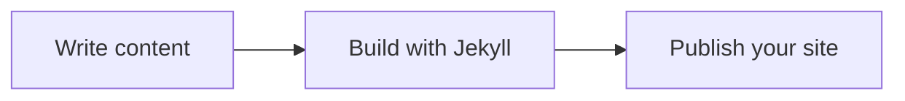

## Mermaid diagram

Set `mermaid: true` in a page's front matter and add a Mermaid code block.

## PhotoSwipe gallery

Select an image to open the viewer. Use the arrow keys to move between images
and Escape to close it. Without JavaScript, each link opens the original image.
These sample images are served by Picsum Photos and require a network connection.




Enable the viewer by passing the unquoted boolean `photoswipe=true` to
`snippets/masonry.html` or `snippets/carousel.html`.

See the [page and snippet reference](https://dieghernan.github.io/chulapa/docs/04-layouts)
for configuration details. Both features require Chulapa 2.2.0 or later.
